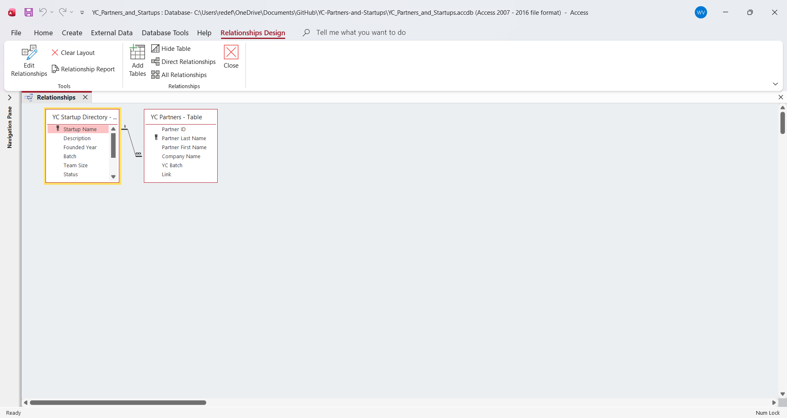

  <h1>🟧 YC Partners and Startups</h1>

  

    A relational database connecting Y Combinator partners
    with the startups they founded.
  

<h2>📑 Table of Contents</h2>

<ul>
  <li><a href="#objective">Objective</a></li>
  <li><a href="#project-details">Project Details</a></li>
  <li><a href="#dataset">Dataset</a></li>
  <li><a href="#images">Images</a></li>
</ul>

<h2>🎯 Objective</h2>

  This project connects Y Combinator
  partners to the startups they founded, including each
  company's description, founded year, batch, team size,
  status, industries, location, and website. The data
  was collected from the YC website and joined with Microsoft Access.

<h2>🛠️ Project Details</h2>

  <strong>Tools:</strong> Microsoft Access

<h2>📊 Dataset</h2>

<h3>YC Partners Table</h3>

<ul>
  <li>Partner ID</li>
  <li>Partner Last</li>
  <li>Partner First</li>
  <li>Company Name</li>
  <li>YC Batch</li>
  <li>Link</li>
</ul>

<h3>YC Startup Directory Table</h3>

<ul>
  <li>Startup Name</li>
  <li>Description</li>
  <li>Founded Year</li>
  <li>Batch</li>
  <li>Team Size</li>
  <li>Status</li>
  <li>Industry 1</li>
  <li>Industry 2</li>
  <li>Location</li>
  <li>Website</li>
</ul>

<h3>YC Partners and Startups Relationships</h3>

<ul>
  <li>Company Name (YC Partners Table)</li>
  <li>Startup Name (YC Startup Directory Table)</li>
</ul>

<h2>🖼️ Images</h2>

<h3>YC Partners Table</h3>

<table>
  <tr>
    <td>
      
    </td>
  </tr>
</table>

<h3>YC Startup Directory Table</h3>

<table>
  <tr>
    <td>
      
    </td>
  </tr>
</table>

<h3>YC Partners and Startups Relationships</h3>

<table>
  <tr>
    <td>
      
    </td>
  </tr>
</table>

  

    <a href="https://github.com/redefiningvicky/Technical-Projects">
      Back to Technical Projects
    </a>
    &nbsp; • &nbsp;
    <a href="https://github.com/redefiningvicky/redefiningvicky">
      Back to Portfolio
    </a>
  

